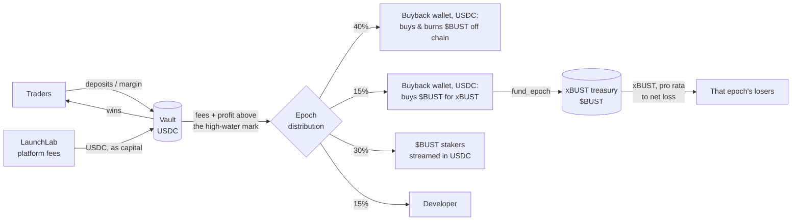
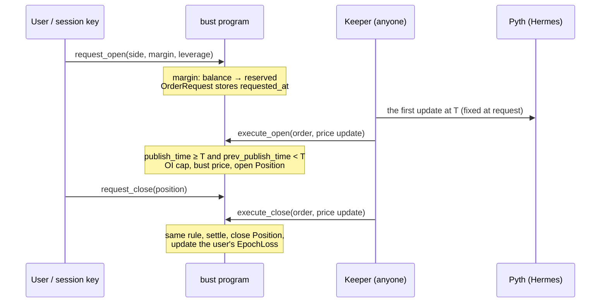

# bust-program

[](https://github.com/get-bust/bust-program/actions/workflows/ci.yml)
[](https://github.com/get-bust/bust-program/actions/workflows/random.yml)

The Solana program behind Bust: leveraged perpetuals traded against a single USDC vault, with the vault's
profit shared between $BUST stakers, a buyback, and the traders who lost.

- [Overview](#overview)
- [Accounts](#accounts)
- [Instructions and who can call them](#instructions-and-who-can-call-them)
- [Deposits](#deposits)
- [Trading](#trading)
- [Settlement](#settlement)
- [Payout queue](#payout-queue)
- [Epoch distribution](#epoch-distribution)
- [$BUST staking](#bust-staking)
- [xBUST](#xbust)
- [LaunchLab platform fees](#launchlab-platform-fees)
- [Economics](#economics)
- [Ledger invariants](#ledger-invariants)
- [Trust model](#trust-model)
- [Parameters](#parameters)
- [Build and test](#build-and-test)
- [Verifying a deployment](#verifying-a-deployment)
- [License](#license)

---

## Overview

Traders deposit USDC and open long or short positions with up to 1000× leverage on markets priced by Pyth.
There is no order book and no counterparty matching: the vault takes the other side of every trade. A
losing trade pays the vault, a winning trade is paid by it.

Fees and the vault's profit are distributed once per epoch (one day):



The vault keeps part of its profit before the split. The share it keeps follows how much of its capacity
traders used over the last seven days (time-weighted), between 20% and 80%.

## Accounts

Every account is a PDA of the program.

| Account | Seeds | Holds |
|---|---|---|
| `Config` | `config` | admin, USDC mint, pause flag, trading parameters, market count |
| `Vault` | `vault` | the ledger: cash, user balances, open margin, accrued fees, queue counters |
| vault token account | `vault_tokens` | all USDC: deposits, margin, vault cash, fees and undistributed shares |
| `Market` | `market`, index (u16) | Pyth feed id, impact size parameter, open interest per side; indexes run 0..market_count with no gaps |
| `UserAccount` | `user`, owner | balance, reserved and queued amounts, session key, order, position and ticket counters |
| `Ticket` | `ticket`, owner, id | one queued win: its place on the queue line and how much was claimed |
| deposit address | `deposit`, owner | owns the user's deposit token account (usually its ATA); holds no data |
| `OrderRequest` | `order`, owner, id | a pending open or close and the time it was requested |
| `Position` | `position`, owner, id | side, margin, leverage, notional, entry and bust prices |
| `Distributor` | `distributor` | epoch counter, high-water mark, 7-day utilisation ring, the four shares, epoch loss |
| `StakePool` / stake tokens | `stake_pool` / `stake_tokens` | staked $BUST and the reward stream |
| `StakeAccount` | `stake`, owner | a staker's stake, pending unstake and unclaimed USDC |
| `Treasury` / treasury tokens | `treasury` / `treasury_tokens` | $BUST backing xBUST, locked and unclaimed xBUST |
| xBUST mint | `xbust_mint` | classic SPL mint; the treasury is its only authority, no freeze authority |
| `EpochRecord` | `epoch`, epoch | an epoch's total net loss and its xBUST pool |
| `EpochLoss` | `epoch_loss`, owner, epoch | one user's net result in one epoch |
| `Vest` | `vest`, owner | a user's xBUST lock |
| `LaunchConfig` | `launch_config` | the LaunchLab program, platform config, quote mint, swap destination |
| fee wallet | `fee_wallet` | the LaunchLab platform's fee wallet; the program signs for it |

## Instructions and who can call them

| Caller | Instructions |
|---|---|
| Admin | `initialize`, `update_config`, `set_paused`, `add_market`, `init_distributor`, `update_distributor`, `init_stake_pool`, `init_treasury`, `update_treasury`, `migrate_treasury`, `init_launch_config`, `update_launch_config` |
| Account owner | `create_user`, `deposit`, `withdraw`, `set_session`, `revoke_session`, `stake`, `request_unstake`, `withdraw_unstaked`, `claim_rewards`, `lock_xbust`, `convert_vested` |
| Owner or session key | `request_open`, `request_close` |
| Buyback authority | `fund_epoch` |
| Anyone (keepers) | `sweep_deposit`, `observe_price`, `execute_open`, `execute_close`, `cancel_order`, `liquidate`, `harvest`, `claim_ticket`, `record_utilization`, `distribute`, `withdraw_bucket`, `claim_xbust`, `close_unfunded_loss`, `claim_launch_fees`, `sweep_launch_fees`, `seed_vault` |

The permissionless instructions cannot move money anywhere the program has not fixed in advance:
`withdraw_bucket` pays only the registered wallets, `claim_xbust` mints only to the loser's account, and the
fills, liquidations and deposit sweeps settle against the user's own account.

A separate rent payer can sign `create_user`, `request_open` and `request_close`, so a relayer can sponsor
users who hold no SOL. Rent always goes back to whoever paid it.

## Deposits

A user can deposit by signing `deposit` from their wallet, or by sending USDC to their **deposit address**, from
an exchange or any other wallet. The deposit address is the associated token account of the PDA
`["deposit", owner]`. `sweep_deposit` moves the whole balance of a USDC account owned by that PDA into the vault
and credits the owner. It needs no signature from the owner, so a keeper sweeps new deposits as they arrive.
Balances under `min_sweep` (1 USDC) wait until more arrives, so dust cannot make keepers pay a transaction each.

The owner is taken from the user account and the PDA is derived from it, so a deposit can only ever be
credited to the address's owner. Only USDC is swept; other tokens sent there stay where they are. Sweeping
works while the program is paused.

Some exchanges refuse to withdraw to a token account whose owner is a PDA; for those, the token account
address itself is the one to give.

## Trading

### Two-step orders

If a user could open at a price they put in the transaction, they could wait for a Pyth update they like, or
trade on a move they already saw off chain. At high leverage that is free money taken from the vault. So every
open and close takes two steps, and the second step has exactly one possible price:



- **One fill price.** An order fills at the first Pyth update on its feed published at or after its fill time
  `T`: `publish_time ≥ T` and `prev_publish_time < T`. Pyth signs
  `prev_publish_time` into every update, so exactly one message qualifies and nobody can forge another.
- **No choosing, no skipping.** Anyone can fill, including a user running their own keeper, but there is
  nothing to choose between. Not filling does not help either: the price is fixed once `T` passes, Hermes
  serves that same message for any past second, and any keeper can fill with it later.
- **The fill time** is set at request as `T = max(chain clock, market.last_publish_time) + fill_delay_sec`
  (2 s). Each market keeps the newest Pyth publish time it has seen, from fills, liquidations and the
  permissionless `observe_price`, and that value never moves back. So `T` follows the Pyth timeline: even if the
  chain clock lags real time, the fill price is one nobody had seen when the request landed.
- **That holds as long as `fill_delay_sec` is longer than how far `last_publish_time` can trail real time.**
  The relayer puts an `observe_price` with the latest Hermes update in the same transaction as every request it
  sends, so for those `last_publish_time` is current; and keepers call `observe_price` every second for every
  market, so for a request sent some other way it trails by about a second plus the time to land. A deployment
  that observes less often needs a longer `fill_delay_sec`.
- **Cancelling is decided by the fill message too.** An order can be cancelled only with its fill message as
  proof that it cannot fill the order: it came more than `max_fill_gap_sec` (10 s) after `T`, meaning Pyth was
  down, or its confidence is too wide (below). Otherwise the order can only be filled. Whether an order fills or
  cancels is never a choice, so waiting for nobody to fill and cancelling is not a way out of a bad price. A
  close order whose position was liquidated in the meantime cancels without a price. An open order the caps
  refuse at its fill cancels as well: left waiting it would keep its margin locked, and whoever freed the cap
  later could fill it at a price long gone. Keepers cancel such an order as soon as the fill is refused.
- Fill prices need at least 3 verified Wormhole signatures under partial verification and a confidence interval
  within 0.2% of the price. **An open** must also be within a quarter of what its margin covers:
  `conf / price × leverage ≤ 25%`, so at 1000×, where the margin covers a 10 bps move, at most 2.5 bps of
  uncertainty; nobody opens at an entry that is noise next to their margin. A close does not take this bound:
  its price is fixed all the same and the uncertainty cuts both ways, and holding closes back in a volatile
  market would keep traders in when they most want out.
- Liquidations are covered below.

### Session keys

The owner can authorise a short-lived key (at most 30 days) that the frontend keeps in the browser, so trades
do not need a wallet prompt each time. A session key is accepted only by `request_open` and `request_close`.
Withdrawals, staking, xBUST and session changes always require the owner, because the PDA is derived from the
signer.

### Liquidation

Each position has a bust price `liq_buffer_ppm` (5 bps) inside the price where its margin would reach zero:

```
long:  entry × (1 − 1/leverage + buffer)
short: entry × (1 + 1/leverage − buffer)
```

Anyone can liquidate a position whose price is past its bust price. The whole margin goes to the vault, less the
loss fee, so whoever liquidates on the vault's side has a reason to pick the harshest price they can. The price
is constrained so there is nothing to pick:

- at most 5 s old, and **no older than the position's own fill price**, so a wick from before the position
  existed cannot liquidate it;
- **no older than the newest price the market has seen**, so a liquidator cannot reach back past a price that
  was not bust;
- **bust at the trader's end of its confidence interval**: `price + conf ≤ bust` for a long, `price − conf ≥
  bust` for a short. An uncertain price does not take the margin. Waiting is not free for the vault: while the
  price is uncertain a position past its bust price stays open, and if the price comes back the trader is saved,
  a small option left with the trader. What the vault gives up is capped at the margin.

### Open interest cap

At fill time two caps apply, each computed on the net vault (cash minus queued debt):

```
per market and side:   OI on that side + new notional ≤ max(net vault × 0.6, oi_floor)
over all markets:      Σ OI on that side + new notional ≤ max(net vault × 0.6, oi_total_floor)
```

- **The total cap** exists because the markets move together. With only per-market caps, longs on BTC, ETH and
  SOL could each reach 0.6 of the vault, 1.8× the vault on one side in a market-wide move.
- **The floors** keep an empty or indebted vault trading. The vault takes the other side of every trade and the
  settlement rules give it an edge, so it fills by being traded against; a cap tied only to the vault would
  keep a new vault empty and stop an indebted one from earning its way back.
- **The floors bound exposure at any moment, not debt.** Positions that close and reopen can keep adding to the
  queue. So past `max_debt` (15,000 USDC) of queued debt the floors shrink in proportion, `floor × max_debt /
  debt`: trading never stops, but the more the vault owes, the smaller the risk it takes on and the more slowly
  the debt can grow. As the debt is paid down the floors grow back, and they are whole again under `max_debt`.
- **Growing with the vault:** once 0.6 × the net vault passes a floor (about 42,000 USDC per market), the cap
  follows the vault and the floor no longer matters; it is only there while the vault is small or in debt.
- **How an indebted vault recovers:** losses on open positions and on new positions within the floors, LaunchLab
  fees and any seeded capital all become cash, and `harvest` hands it to the queue. A client should tell a user
  opening a position while the vault is in debt that a win will be queued.
- 0.6 comes from a year of minute data on a single market: at that level the vault lost at most half of itself
  in the worst 72 hours. The floors are set by the admin and should come from the same kind of stress test.

## Settlement

All amounts are fixed point: prices at 1e-8, USDC in base units, rates in ppm, intermediate values in u128 at
a 1e12 scale. The math matches the off-chain engine to the cent, and the unit tests pin it.

**Loss.** The user loses `min(|PnL|, margin)`. The loss fee (2%) is taken from it into accrued fees and the
rest becomes vault cash.

**Win.** The raw profit is cut before it is paid, so small and very large moves cannot be farmed:

1. **Dead band:** moves under 0.2 bps pay nothing.
2. **Holdback:** inside a small-move band (0.75 to 6 bps), a share `3.597 · width · u²(1−u)²` of the move is
   held back, where `u` is how far through the band the move is. `u²(1−u)²` peaks at 1/16 in the middle of the
   band, so 3.597 makes the largest holdback 22.5% of the band's width, about 1.2 bps.
3. **Impact haircut:** what is left is scaled by `(1 − base) · move / (move + 1/rate + ref / (1e6 · mult))`.
   Both extra terms are moves: `1/rate` is 1/15,000 ≈ 0.67 bps, and `ref / (1e6 · mult)`, with the $100,000
   reference notional and the market's size parameter (484 for ETH, 815 for BTC), is about 2 bps for ETH. A
   win on a move much larger than them keeps close to 90% of its profit; on a move of the same size, about half.
4. **Win fee:** 2% of the result.

The margin always comes back. The profit comes from vault cash; see the payout queue for what happens when cash
is short.

These cuts make the payout far from linear in the move, especially for small moves at high leverage. A client
should show the expected payout of a close before the user sends it, computed with the same rules
(`math::win_breakdown`).

## Payout queue

When vault cash cannot cover a win, the vault pays what it holds and the rest is queued. The queue works like
Lido's withdrawal queue: two counters that only ever grow, on one line.

```
queued_cumulative   every amount ever queued
paid_cumulative     every amount ever paid against the queue
queue_total         queued_cumulative − paid_cumulative   (still owed)
```

Each queued win gets a `Ticket` PDA holding its interval `[start, start + amount)`, where `start` was
`queued_cumulative` at the moment it was queued:

```
A wins 100 the vault cannot pay → A's ticket [0, 100)      queued_cumulative = 100
B wins  50                      → B's ticket [100, 150)    queued_cumulative = 150
harvest pays 120                → paid_cumulative = 120
   A: paid min(120 − 0, 100)   = 100, fully paid
   B: paid min(120 − 100, 50)  =  20, 30 still owed
```

- `harvest` moves `min(cash, queue_total)` from vault cash onto the queue by advancing `paid_cumulative`. It
  touches one account, so its cost does not depend on how many tickets wait, and there is no limit on their
  number.
- `claim_ticket` credits the owner with what the queue has paid on the ticket since the last claim. Anyone can
  call it; the money can only reach the ticket's owner. A fully paid ticket closes and its rent goes back to
  the keeper who opened it.
- Tickets are paid strictly in the order they were queued, whatever order they are claimed in.
- The ticket's PDA is created during the close. Lamports sent to that address beforehand do not block it.

While anything is owed:

- new wins pay nothing up front and are queued whole;
- no fees are taken, since they would come out of money already owed;
- the open interest caps are computed on cash minus the debt, so they shrink to the floors;
- `distribute` refuses to run. Paid but unclaimed tickets do not hold it up.

## Epoch distribution

Once an epoch has ended and the queue is empty, anyone can call `distribute`:

```
profit    = vault cash − high-water mark − what open positions are up
keep      = clamp(highest daily average utilisation over the last 7 days, 20%, 80%)
from_cash = profit × (1 − keep)
pool      = from_cash + accrued fees
burn 40% · stakers 30% · xBUST 15% · developer 15% (rounding remainder to the developer)
```

- **Open positions.** Cash the vault holds is not all profit while traders are up on open positions: those wins
  will be paid out of it. Each market keeps `Σ notional / entry` per side next to its open interest, so a
  side's unrealised PnL at any price is one formula (`p · Σ(n/e) − Σn` for longs). `distribute` must be given
  every market and a price for each no older than 5 s, or it fails; it adds up the sides that are up (before haircuts, and without netting the sides that
  are down, so it is an upper bound) and holds that back from the profit.
- **High-water mark.** Profit is only what vault cash gained since the last distribution. A losing stretch has
  to be won back before anything is paid out. `seed_vault` and LaunchLab fees raise the mark by what they add,
  so capital put in is never distributed as profit.
- **Utilisation.** `record_utilization` samples `max(OI long, OI short) / cap` over every market, and the total
  over all markets against its own cap. It must be given exactly markets `0..market_count` in index order and
  reads only market accounts the program owns, so the caller cannot leave out the busiest market or choose the
  number. Each sample counts from
  when it is recorded until the next one, and each day keeps the integral, so a day's figure is a time-weighted
  average: opening a huge position for a few seconds and sampling it many times weighs only those seconds.
- **The money stays put.** The shares are ledger entries; the USDC stays in the vault token account until it is
  withdrawn. The burn and xBUST shares can only go to the registered buyback wallet and the developer share
  only to the registered developer wallet. The staker share never leaves through `withdraw_bucket`.
- The closing epoch's total net loss is frozen into an `EpochRecord` for xBUST.

## $BUST staking

Each distribution hands the staker share to the stake pool, which streams it second by second over the next
epoch (Synthetix StakingRewards). A staker earns in proportion to their stake for the time they were staked,
so staking just before a distribution and leaving after it earns almost nothing. Reward that streams while
nobody is staked is not lost: it is added to the next distribution's stream. If nobody is staked at a
distribution, the share and anything orphaned go to the burn instead.

`request_unstake` stops rewards at once and releases the $BUST after the pool's unstake period. Rewards are
paid in USDC from the vault token account and can never exceed what was set aside for stakers.

## xBUST

xBUST is the losers' share of each epoch.

1. **Recording.** Every close and liquidation updates the user's `EpochLoss` with their net result, so a win in
   the same epoch reduces an earlier loss. The distributor keeps the epoch's total.
2. **Funding.** The buyback wallet withdraws the xBUST share in USDC, buys $BUST and calls `fund_epoch`. Only
   the registered buyback authority can; otherwise anyone could fund an epoch with one base unit and lock its
   losers out. The $BUST goes into the treasury and opens xBUST rights at the current rate:
   `xbust = bust × (supply + locked + unclaimed) / treasury`, or 1:1 when there are no claims yet.
3. **Claiming.** Each loser receives `loss / total_loss` of the epoch's pool, minted to their own account. The
   record closes and its rent goes back to the keeper who paid it.

   An epoch can be funded for 30 epochs after it closes. Past that window it can no longer be funded, and
   `close_unfunded_loss` closes its loss records so their rent goes back to the keeper.
4. **Selling or waiting.** xBUST is a classic SPL token, so it can be sold. Or the holder locks it: the xBUST
   is burned and unlocks linearly over 30 days into $BUST at that day's rate,

   ```
   rate = treasury $BUST / (xBUST supply + locked xBUST + unclaimed xBUST)
   ```

   xBUST that is sold and burned elsewhere lowers the supply, so the rate rises for those who wait. Adding to a
   lock restarts the clock but keeps what had already unlocked.

`unclaimed` is part of the rate so that an early converter cannot take the backing of losers who have not
claimed yet. New rights open at the current rate so that new losers do not share the surplus that sellers left
to those who wait.

## LaunchLab platform fees

$BUST launches from Bust's own Raydium LaunchLab platform, and the platform's fee wallet is the program's
`fee_wallet` PDA.

- `claim_launch_fees` has LaunchLab pay the platform fee, from one pool or from the platform fee vault, signing
  as the PDA.
- That signature would work for any program it was handed to, so the admin can register only the two Raydium
  LaunchLab program ids (mainnet and devnet).
- `sweep_launch_fees` moves what was claimed. USDC enters the vault as capital and raises the high-water mark.
  Any other quote token goes to the registered swap wallet, to be swapped to USDC and seeded back. Nothing else
  can receive it.

## Economics

The rules above were run over real Pyth candles with the off-chain engine, which implements the same math
(the unit tests pin it to the cent). The simulation lives in the app repository (`sim/run.ts`, `sim/stress.ts`);
these are its results at the default parameters.

**The vault's edge.** Against traders taking random sides it keeps 1–7 bps of volume, from the haircuts on wins
and the bust buffer. At high leverage that is a large share of margin: a 1000× trader holding 15 minutes loses
about a third of the margin per trade on average.

**Floors and debt** (a year of hourly candles, starting from an empty vault, floors of 25,000 USDC per market
and 50,000 in total):

| trader behaviour | worst debt in 24 h | 72 h | 7 days | 30 days |
|---|---|---|---|---|
| knows each window's direction in advance and holds the floors | 7,220 | 13,654 | 15,535 | 20,061 |
| momentum: trades the last hour's direction on the two busiest markets | 5,940 | 7,554 | 8,879 | 11,285 |
| random flow: 20 traders an hour at 10×, 100× and 500× | 981 | 993 | 993 | 993 |

The vault ends the year about 73,000 USDC up from random flow, and 114,000 up against the momentum trader: the
haircuts make trend following lose too. `max_debt` sits at 15,000, about the worst 72 hours of the first row,
which no realistic flow reaches.

**Hedged xBUST farming.** Two accounts open a long and a short together; the losing one earns xBUST for its
loss and the winning one keeps its haircut profit. Over two weeks of minute candles, the cheapest way to do it
(2× held for 4 hours) costs 15.2 cents per dollar of loss counted; trades inside the holdback band cost far
more. With the xBUST share at 15% and the vault keeping the minimum 20%, a dollar of loss earns 2.2–4.7 cents
of xBUST depending on who else trades, so farming would need an xBUST share of 49–104% to break even. Selling
xBUST at the wall for half its value doubles that.

**Seeing Binance first.** A trader who watches Binance and opens toward its gap from Pyth is filled at the first
Pyth update 2 s after the request, so the fill delay should take the gap away. `sim/src/latency.rs` measures that
on all three markets, over 100 moments on each of six days from June to November 2026 and the 100 sharpest
moments of three volatile days, against Hermes prices and Binance 1 s candles. Most of the raw gap is USDT
trading away from USD (about 10 bps); the day's median for the market is taken out first. At the sharpest moments,
at 100× and holding 2 to 10 s:

| strategy | samples | trader's mean result per trade, bps of notional |
|---|---|---|
| random side | 900 | -0.8 to -1.4 |
| follows a gap over 5 bps | 58 | -2.0 to -4.8 |
| fades a gap over 5 bps | 58 | -0.6 to +0.3, ± 0.5 to 2.2 |
| knows the close price in advance | 900 | +1.3 to +4.5 |

Neither direction of the gap pays, and knowing the close outright is worth a few bps. At 1000× the leverage
confidence bound let 6 of those 900 opens through, too few to measure. This is a sample, not a bound: gaps over
10 bps came up 8 times, standard errors understate the noise because markets move together, and it says nothing
about milliseconds or about venues other than Binance.

The candles do not include regimes like March 2020 or 2022, traders are modelled as random or simply
adversarial rather than informed, and xBUST is valued at the $BUST it converts to with $BUST flat.

## Ledger invariants

These hold after every instruction, and the randomised test checks all of them after every step:

```
vault token balance = cash + user_balances + open_margin + fees_accrued + queue_unclaimed
                      + distributor shares
user_balances       = Σ (balance + reserved) over users
queue_total + queue_unclaimed = Σ queued over users
queue_total         = queued_cumulative − paid_cumulative   (debt with no tokens behind it)
epoch_loss          = Σ loss over this epoch's EpochLoss records
```

## Trust model

**The upgrade authority can do anything.** It can replace the program, and a new program can move every token
the vault holds. Everything in the table below assumes the program is the one in this repository. On mainnet
the upgrade authority and the admin will be a Squads multisig with a timelock, so that a change is visible
before it takes effect; once the program has settled, the upgrade authority can be removed for good.

Within the program as written:

| Party | Can | Cannot |
|---|---|---|
| Upgrade authority | everything (see above) | |
| Admin | change parameters and distribution shares within validated bounds; change the registered buyback, developer and swap wallets, and so where future shares go; pause new positions; add markets | withdraw user balances, vault cash or shares already distributed to someone else; register a launchpad other than Raydium LaunchLab |
| Buyback authority | receive the burn and xBUST shares in USDC; fund epochs, or fund them less than the xBUST share, or not at all | mint xBUST or take $BUST out of the treasury |
| Keepers | fill orders, liquidate bust positions, run the permissionless instructions | choose a fill price, liquidate a healthy position, or move funds between users |
| Session key | open and close positions for its owner until it expires | withdraw, stake, lock or change the session |
| Pyth | supply prices | (the program trusts a price that passes the age, signature and confidence checks) |

### What the burn share is

The program does not burn anything. The 40% "burn" share and the 15% xBUST share are USDC that only the
registered buyback wallet can withdraw; buying $BUST with it, burning that $BUST and funding the xBUST treasury
happen off chain and are a commitment of whoever holds that wallet, not something the program enforces. The
part that is on chain is checkable: `BucketWithdrawn` shows the USDC the wallet took, `EpochFundedEvent` the
$BUST it put into the treasury, and the burns are ordinary SPL burns from that wallet.

Pausing stops opens only. Closes, liquidations, harvests and withdrawals keep working, so a pause never traps
funds or leaves a bust position open against the vault.

## Parameters

Defaults from `Params::DEFAULT` and `DistParams::DEFAULT`; the admin can change them within validated bounds.

| Parameter | Default |
|---|---|
| Max leverage | 1000× |
| Min margin | 1 USDC |
| Win fee / loss fee | 2% / 2% |
| Bust price buffer | 5 bps |
| Dead band | 0.2 bps |
| Holdback band | 0.75 – 6 bps |
| Impact base / rate / reference notional | 10% / 15,000 / $100,000 |
| OI cap | max(0.6 × net vault, floor) per market and side, and over all markets per side |
| OI floors | 25,000 USDC per market and side, 50,000 USDC over all markets; past 15,000 USDC of debt, × 15,000 / debt |
| Minimum deposit sweep | 1 USDC |
| Max price age / confidence | 5 s / 0.2%, and on opens at most 25% of the margin's move (2.5 bps at 1000×) |
| Min Pyth signatures | 3 |
| Fill delay / largest gap before a fill message counts as an outage | 2 s / 10 s |
| Max session | 30 days |
| Epoch | 1 day |
| Vault share of profit | 20% – 80%, by the highest daily average utilisation of the last 7 days |
| Shares | 40% burn, 30% stakers, 15% xBUST, 15% developer |

The unstake period and the xBUST unlock period are set when the stake pool and treasury are created (the
tests use 7 and 30 days).

## Build and test

Requires Rust 1.89.0 (pinned in `rust-toolchain.toml`), the Solana CLI and Anchor 1.2.1.

```sh
anchor build          # or: cargo build-sbf
cargo test
cargo kani -p bust --lib
BUST_RANDOM_SEEDS=300 BUST_RANDOM_STEPS=500 cargo test -p bust --test random_walk
```

CI runs all of it: lint, tests, proofs and the simulator on every push, and a longer random walk every night.

The integration tests run on [LiteSVM](https://github.com/LiteSVM/litesvm) against the SBF build in
`target/deploy/bust.so`, so build before testing. Pyth prices are written directly as `PriceUpdateV2`
accounts.

```
programs/bust/src/
  lib.rs              instruction entry points
  state.rs            accounts and parameters
  math.rs             settlement and distribution math, with unit tests
  proofs.rs           Kani proofs of the math and accounting rules
  instructions/       admin, user, trade, queue, distribution, staking, xbust, launchlab
programs/bust/tests/
  common/mod.rs       LiteSVM harness
  *.rs                one file per module, plus invariants.rs and random_walk.rs (randomised)
sim/
  src/                the program's settlement over historical prices (cargo test, from sim/)
  scripts/            fetch the data; python3 scripts/test_fetch_pyth.py
```

## Verifying a deployment

Release builds are reproducible with [solana-verify](https://github.com/Ellipsis-Labs/solana-verifiable-build):

```sh
solana-verify build --library-name bust
solana-verify get-program-hash -u <cluster> <program id>
solana-verify get-executable-hash target/deploy/bust.so
solana-verify verify-from-repo -u <cluster> --program-id <program id> \
  https://github.com/get-bust/bust-program --commit-hash <commit> --library-name bust
```

## License

Business Source License 1.1. See [LICENSE](LICENSE).
